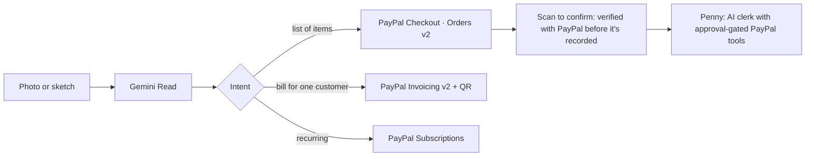

# Paperstall

**Draw it. Snap it. Get paid.**

Photograph a chalkboard menu, a handwritten bill or a lessons notice. Paperstall reads what it means and gives you a
real way to get paid with PayPal: a storefront with PayPal Checkout, a PayPal invoice with a QR code, or a PayPal
subscription plan. Then Penny, an AI clerk, helps run the back office, and every action that moves money waits for
your approval.

> **Status:** early build (Phase 0: scaffold and design system). Live demo, video and judge login come later.

## Judge quick path
_Added when the hosted demo is live: sandbox buyer login + 4 steps._

## Who it's for
Small sellers anywhere who run on paper (market stalls, food trucks, craft fairs, tutors, small workshops) and skip
online payments because setup feels like work.

## How it works (planned)


## Built with
Next.js 16, TypeScript, Tailwind CSS v4, shadcn/ui, motion, zod. PayPal and Gemini integrations land in Phase 1;
Channel3 powers the market check (Phase 2).

## Run locally
Prerequisites: Node 22+, pnpm 9.
```bash
pnpm install
cp .env.example .env.local   # fill in your own sandbox values
pnpm dev
```
Checks: `pnpm lint && pnpm typecheck && pnpm test && pnpm build`.

## Docs
[Architecture](docs/ARCHITECTURE.md) · [PayPal integration](docs/PAYPAL-INTEGRATION.md) · [AI](docs/AI.md) ·
[Decisions](docs/DECISIONS.md) · [Integrate](docs/INTEGRATE.md) · [Demo](docs/DEMO.md) · [Security](SECURITY.md) ·
[Tasks](docs/TASKS.md) · [Changelog](CHANGELOG.md)

## License
[MIT](LICENSE)
