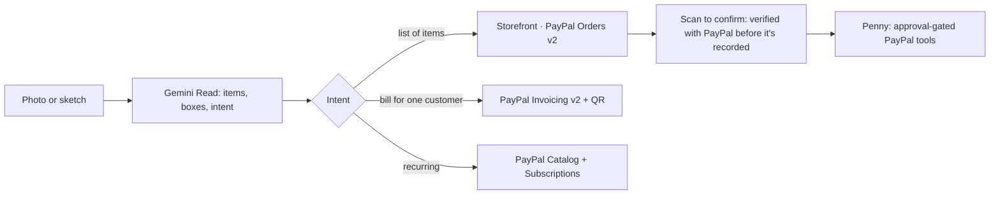

# Paperstall

**Draw it. Snap it. Get paid.**

Photograph a chalkboard menu, a handwritten bill or a lessons notice. Paperstall reads what it means with Gemini and
gives you a real way to get paid with PayPal: a storefront with PayPal Checkout, a PayPal invoice with a QR code, or a
PayPal subscription plan. Every sale is verified with PayPal before it's recorded, and Penny, an AI clerk, helps run the
back office, but anything that moves money waits for your approval.

> **Status:** the app works end to end; it hasn't been deployed or run against the PayPal sandbox yet. Live URL, demo video and judge login are coming.

## Judge quick path
_Added with the hosted demo: sandbox buyer login + 4 steps (also shown on the landing page)._

## Who it's for
Small sellers anywhere who run on paper (market stalls, food trucks, craft fairs, tutors, small workshops) and skip
online payments because setting them up feels like work.

## How it works


## PayPal integration
Orders v2 (create, capture, get, track), Payments v2 (refunds), Invoicing v2 (create, send, QR, remind, cancel),
Catalog Products + Subscriptions (plans, subscriptions) and the JS SDK v6 buttons. Every endpoint, file and decision
is in [docs/PAYPAL-INTEGRATION.md](docs/PAYPAL-INTEGRATION.md).

## AI usage
- **Gemini** (`gemini-3-flash-preview` for reading, `gemini-3.5-flash-lite` for chat), chosen by `pnpm probe:gemini`.
- Structured output with a zod schema and 0–1000 bounding boxes; one repair attempt.
- Code-side checks: math check, sanity checks, acceptable-use classification.
- **Penny** uses Gemini function calling over PayPal tools; refunds, reminders, cancellations, invoices and shipping only become Approval Cards.
- A buyer concierge proposes carts from the stall's own items only.

Details: [docs/AI.md](docs/AI.md).

## Sponsor tools
- **Channel3** powers the market check. For branded items the Read flags, it shows a price range across stores, a suggested price, a typo-style price guard ("$3.50 for AirPods? Did you mean …?") and an optional product photo. Matching rules are in `src/core/market.ts`.
- **APIMatic Context Plugin:** not used yet. So far, PayPal request and response shapes were checked against PayPal's published OpenAPI specs.
- **Postman:** `pnpm postman` generates `postman/paperstall.postman_collection.json` from the OpenAPI spec.

## Architecture decisions
No database (signed URL payloads + localStorage), payee-email multi-seller model, verify-to-record, integer minor
units, idempotency keys. See [docs/DECISIONS.md](docs/DECISIONS.md), [SECURITY.md](SECURITY.md) and
[docs/INTEGRATE.md](docs/INTEGRATE.md). The API is documented at `/docs/api` with the spec at `/api/v1/openapi.json`.

## Run locally
Prerequisites: Node 22+, pnpm 9, a PayPal sandbox REST app (with Invoicing and Subscriptions), a Gemini API key.
```bash
pnpm install
cp .env.example .env.local   # fill in your own sandbox values
pnpm dev
```
- Checks: `pnpm lint && pnpm typecheck && pnpm test && pnpm build`.
- Plumbing check (dev only): `/dev/health`.
- Pick Gemini models: `pnpm probe:gemini`.

## Known limitations
- Sandbox only.
- The ledger lives on one device (export/import to move it).
- Sales from other devices arrive via Scan to confirm.
- FX rate is set by the seller, not live.
- Free-tier AI rate limits (the UI counts down and retries).
- Penny's replies aren't streamed.
- Subscriber lists only include subscription IDs this device has seen.

## License
[MIT](LICENSE)
