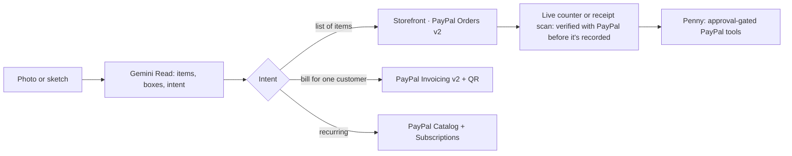

# Paperstall

**Draw it. Snap it. Get paid.**

Photograph a chalkboard menu, a handwritten bill or a lessons notice. Paperstall reads what it means with Gemini and
gives you a real way to get paid with PayPal: a storefront with PayPal Checkout, a PayPal invoice with a QR code, or a
PayPal subscription plan. Customers order and pay from their own phone; each paid order pops up on the seller's live
counter only after PayPal confirms it, so fake payment screenshots don't work. Penny, an AI clerk, helps run the back
office, but anything that moves money waits for your approval.

> **Status:** runs end to end against the PayPal sandbox: stall checkout → receipt → verified sale, invoices with QR,
> billing plans, refunds. Live demo: _DEPLOY_URL_ · Demo video: coming.

## Judge quick path
1. Open the live demo and go to **New** → **Samples** → *Rosa's Coffee Cart* (or *Tacos Doña Maria* for a Spanish menu).
2. Check the Read, keep **Shop**, then **Continue** → **Publish**, and open the storefront link.
3. Keep the studio's **Live counter** open in one tab. In another tab (or on your phone), add a few items on the
   storefront and pay with PayPal using the sandbox buyer login shown on the landing page.
4. The order appears on the live counter with the buyer's pickup code, checked with PayPal, and lands in the ledger.
   No counter open? **Check a payment** scans the receipt QR (or takes the order ID) instead. Scan a counted receipt
   again and it says "Already recorded".

Also try *Sam Lee Design* (invoice + QR), *Piano Lessons* (subscription plan), and **Studio → Penny** ("refund the last order").

## Who it's for
Small sellers anywhere who run on paper (market stalls, food trucks, craft fairs, tutors, small workshops) and skip
online payments because setting them up feels like work.

## How it works


## Live counter
Customers order from the stall's QR poster on their own phone. After PayPal confirms the capture, the server posts only
the order ID to a private [ntfy.sh](https://ntfy.sh) topic for that stall; the seller's studio hears it, checks the order
with PayPal itself (paid, right amount, right payee, not already counted) and shows it with a 4-character pickup code that
matches the buyer's receipt. The topic travels inside the signed stall link only sealed (AES-GCM), so buyers can't read
it. A forged message just fails the PayPal check. One browser tab per stall records orders, and devices share what they
counted, so a receipt is never counted twice. Details: [ADR-012](docs/DECISIONS.md).

## PayPal integration
Orders v2 (create, capture, get, track), Payments v2 (refunds), Invoicing v2 (create, send, QR, remind, cancel),
Catalog Products + Subscriptions (plans, subscriptions) and the JS SDK v6 buttons. Every endpoint, file and decision
is in [docs/PAYPAL-INTEGRATION.md](docs/PAYPAL-INTEGRATION.md).

## AI usage
- **Gemini** (`gemini-3-flash-preview` for reading, `gemini-3.5-flash-lite` for chat), chosen by `pnpm probe:gemini`.
- Structured output with a zod schema and 0–1000 bounding boxes; one repair attempt.
- Code-side checks: math check (lines + written tax vs. the written total), sanity checks, acceptable-use classification.
- Tax on the paper is read separately and charged as a rate on every cart (PayPal `tax_total`).
- **Penny** uses Gemini function calling over PayPal tools; refunds, reminders, cancellations, invoices and shipping only become Approval Cards.
- A buyer concierge proposes carts from the stall's own items only.

Details: [docs/AI.md](docs/AI.md).

## Sponsor tools
- **Channel3** powers the market check. For branded items the Read flags, it shows a price range across stores, a suggested price, a typo-style price guard ("$3.50 for AirPods? Did you mean …?") and an optional product photo. Matching rules are in `src/core/market.ts`.
- **APIMatic Context Plugin:** not used yet. So far, PayPal request and response shapes were checked against PayPal's published OpenAPI specs.
- **Postman:** `pnpm postman` generates `postman/paperstall.postman_collection.json` from the OpenAPI spec.

## Architecture decisions
No database (signed URL payloads + localStorage), payee-email multi-seller model, verify-to-record, integer minor
units, idempotency keys. See [docs/DECISIONS.md](docs/DECISIONS.md), [SECURITY.md](SECURITY.md) and
[docs/INTEGRATE.md](docs/INTEGRATE.md). The API is documented at `/docs/api` with the spec at `/api/v1/openapi.json`.

## Run locally
Prerequisites: Node 22+, pnpm 9, a PayPal sandbox REST app (with Invoicing and Subscriptions), a Gemini API key.
```bash
pnpm install
cp .env.example .env.local   # fill in your own sandbox values
pnpm dev
```
- Checks: `pnpm lint && pnpm typecheck && pnpm test && pnpm build`.
- Plumbing check (dev only): `/dev/health`.
- PayPal sandbox setup: use **US** sandbox business (payee) and personal (buyer) accounts, and create the app on that business account with Invoicing and Subscriptions enabled. If you enable a feature after the server has fetched a token, restart it (see [docs/PAYPAL-INTEGRATION.md](docs/PAYPAL-INTEGRATION.md)).
- Pick Gemini models: `pnpm probe:gemini`.

## Known limitations
- Sandbox only.
- The ledger lives on one device (export/import to move it).
- Live orders depend on the public ntfy.sh service (250 messages a day per sender on its free tier); if it's down or
  over the limit, sellers scan receipts instead. Self-host ntfy for real traffic.
- Stalls published before the live counter existed need publishing again to ring it.
- FX rate is set by the seller, not live.
- Free-tier AI rate limits (the UI counts down and retries).
- Penny's replies aren't streamed.
- Subscriber lists only include subscription IDs this device has seen.

## License
[MIT](LICENSE)
