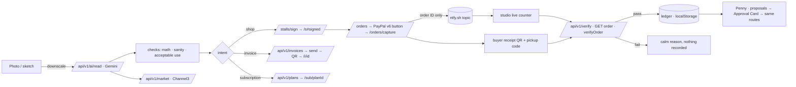

# Architecture

Paperstall has no database. Seller state lives on the seller's device; public storefronts live in the URL.

## Modules

```
src/
  core/                  framework-agnostic: no Next.js imports
    read/                Read schema, prompt, math + sanity checks
    rails/               Rail interface (one adapter per PayPal product)
    verify/              verifyOrder(order, stall, recorded) → Verdict
    doorbell.ts          live-counter message shapes (shared, no secrets)
    agent/               Penny's tools + approval gate
    money.ts             integer minor units, PayPal decimal strings
    stall.ts, signing.ts, peek.ts   stall payload, HMAC signing, browser-safe decode
    market.ts            Channel3 matching, range, price guard
    openapi.ts           OpenAPI 3.1 from zod
  server/                server-only adapters
    paypal/              typed REST client + operations
    gemini.ts            generate / generateJson with backoff and repair
    doorbell.ts          sealed topics, pickup codes, ring after capture
    channel3.ts, read.ts, stall.ts, http.ts
  app/                   Next.js App Router pages and /api/v1 routes
  components/            UI: ink circle, stamp, approval card, PayPal button, scanner, receipts
  lib/                   client store (zustand persist), API client, image tools, theme, CSP,
                         doorbell client + useLiveCounter (one tab per stall via Web Locks)
  proxy.ts               per-request nonce, CSP and security headers
```

## Flow



## The "no database" model
- Seller state: one versioned zustand store `paperstall:v1` in `localStorage` (stalls, ledger, invoices, plans, receipts, settings, item art with an LRU size cap), with a `migrate` hook for v2. Export/import JSON in Settings.
- Storefronts: `lz-string` payload + HMAC in the URL hash (430 characters for a 4-item stall). The hash never reaches the server except when a route is called with it, and every money route re-verifies the signature and recomputes prices.
- Buyer receipts stay on the buyer's device. The seller's live counter hears about each paid order through the stall's ntfy.sh topic and records it only after its own PayPal check; scanning the receipt is the fallback (verify-to-record, [ADR-003](DECISIONS.md); live counter, [ADR-012](DECISIONS.md)).
- The doorbell topic is generated at publish, returned to the seller once, and carried in the link only sealed with AES-256-GCM under a key derived from the signing secret. Devices post "counted" messages to the same topic, so a second device refuses a receipt the first already accepted.

## Rendering
Every page renders per request so the CSP nonce is fresh ([ADR-005](DECISIONS.md)). Heavy pieces (draw pad, ledger, Penny, scanner) are lazy-loaded.
