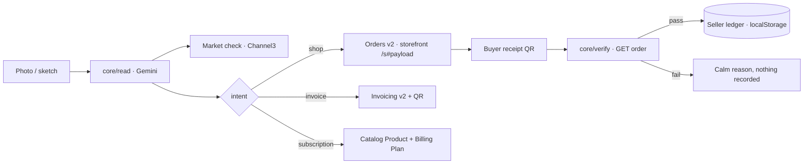

# Architecture

Paperstall has no database. Seller state lives on the seller's device; public storefronts live in the URL.
This page describes what exists today; planned work is in [TASKS.md](TASKS.md).

## Modules (today)

```
src/
  app/                 Next.js App Router (one consumer of the core)
    layout.tsx         fonts, theme init script (nonced), header shell
    page.tsx           landing
    design/            design-system page (tokens, type, buttons, cards, ink circle, stamp)
  components/
    ui/                shadcn/ui (Radix) components, restyled with Ink & Ledger tokens
    ink/               InkCircle (self-drawing stroke around a 0–1000 box), Stamp
    site-header.tsx, theme-toggle.tsx
  core/                framework-agnostic: no Next.js imports
    read/              image → Read (types only so far)
    rails/             `Rail` interface; one adapter per PayPal rail
    verify/            verdict reasons (types only so far)
    agent/             tool effect types (types only so far)
  lib/
    env.ts             zod-validated server env (server-only)
    csp.ts             CSP builder + security header values
    theme.ts           theme storage key + pre-paint script
  proxy.ts             per-request nonce, CSP and security headers
```

## Planned data flow



## The "no database" model
- Seller state: one versioned zustand store `paperstall:v1` in `localStorage`.
- Storefronts: HMAC-signed, compressed payload in the URL hash; API routes re-validate it and recompute amounts.
- Sales enter the ledger only after PayPal confirms them ([ADR-003](DECISIONS.md)).

## Rendering
Every page is rendered per request: the CSP nonce must be fresh each time, so `cacheComponents` is off ([ADR-005](DECISIONS.md)).
